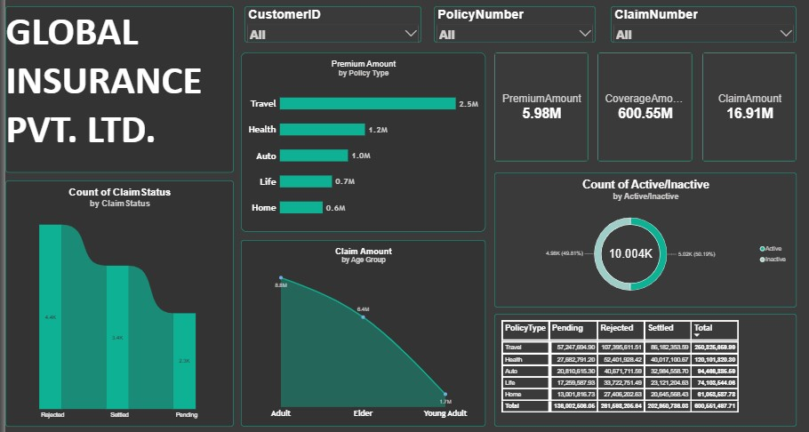
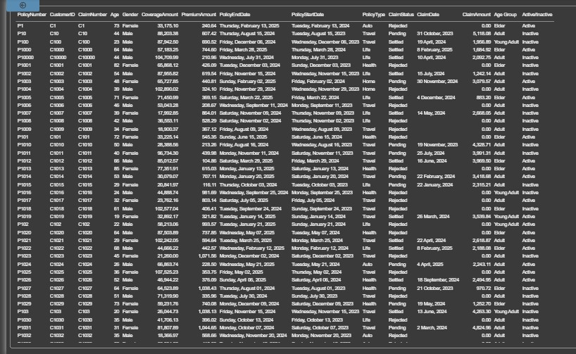

# Global Insurance Performance & Claims Analytics Report

## Project Overview
This interactive Power BI Report provides a comprehensive analytical view of policy performance, claims settlement status, and demographic exposure for Global Insurance Pvt. Ltd. The report enables data-driven evaluation of insurance portfolios across multiple business lines.

## Key Performance Indicators (KPIs)
* **Total Premium Volume:** $5.98M
* **Total Coverage Exposure:** $600.55M
* **Total Incurred Claims:** $16.91M
* **Total Policies Tracked:** 10,004+ (Active vs Inactive)

## Key Insights & Visualizations
* **Policy Distribution:** Tracks premium contribution across Travel ($2.5M), Health ($1.2M), Auto ($1.0M), Life ($0.7M), and Home ($0.6M) policies.
* **Claims Settlement Analysis:** Categorizes claim volumes by status (Settled, Rejected, Pending).
* **Demographic Breakdown:** Analyzes claims distribution across Adult, Elder, and Young Adult age groups.
* **Granular Matrix:** Cross-analyzes policy categories against pending, settled, and rejected claim values.

## Technical Skills & Tools Used
* **Business Intelligence:** Microsoft Power BI Desktop
* **Data Transformation:** Power Query for schema cleaning, type conversions, and date parsing
* **Data Modeling & DAX:** Measures for aggregate calculations, KPI cards, and policy status classification

## Report Preview

### Visual Analytics Report

### Data Records & Claims Matrix

